<p align="center">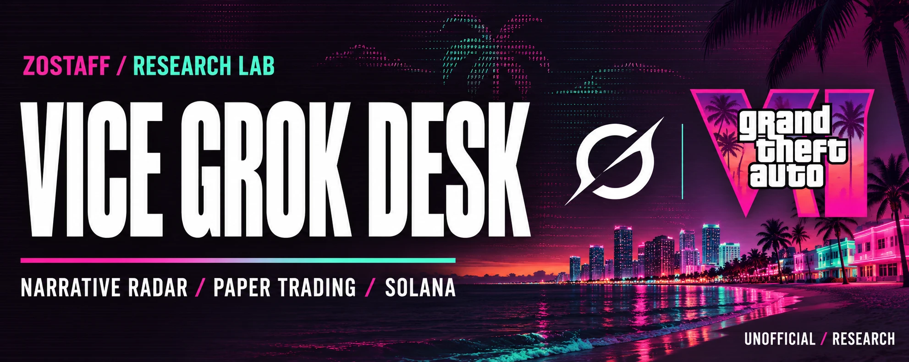</p>

<p align="center">
  
  
  
  
  
</p>

<p align="center">
  <b><a href="#quick-start">[ start ]</a></b> ·
  <b><a href="#rules">[ pipeline ]</a></b> ·
  <b><a href="#replay">[ replay ]</a></b> ·
  <b><a href="#grok">[ grok ]</a></b> ·
  <b><a href="#repository">[ internals ]</a></b> ·
  <b><a href="#scope">[ scope ]</a></b>
</p>

<p align="center"></p>

**Three feeds. Two-source consensus. One paper desk.**

Grok-assisted narrative research for Solana memecoins. I built this desk to turn matching news events into explicit, inspectable trading rules: detect a narrative, check the candidate, size a paper position, and record every decision.


**Status: research MVP.** Runs locally with zero dependencies. Includes deterministic replay, optional Grok text classification, token snapshot filters, simulated execution, and JSONL journals. No wallet connection or real transactions.

The included dataset is synthetic. This repository does **not** substantiate historical returns, launch dates, token prices, or the trading results described in social posts.

<p align="center">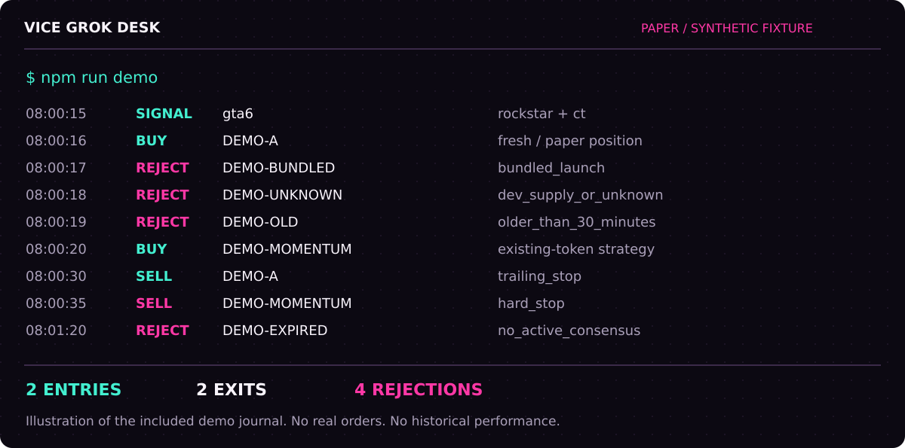</p>

<a id="quick-start"></a>
<p align="center">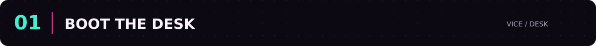</p>

Node.js 22 or newer. No install or API key required for the demo.

```bash
git clone https://github.com/zostaff/vice-grok-desk.git
cd vice-grok-desk
npm run demo
npm test
```

The demo produces two paper entries, rejects bundled/unknown/old candidates, triggers a trailing stop and a hard stop, and rejects an expired signal. Each run writes `runs/<timestamp>-<pid>/journal.jsonl` and `summary.json`.

<a id="rules"></a>
<p align="center">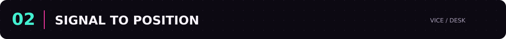</p>

<p align="center">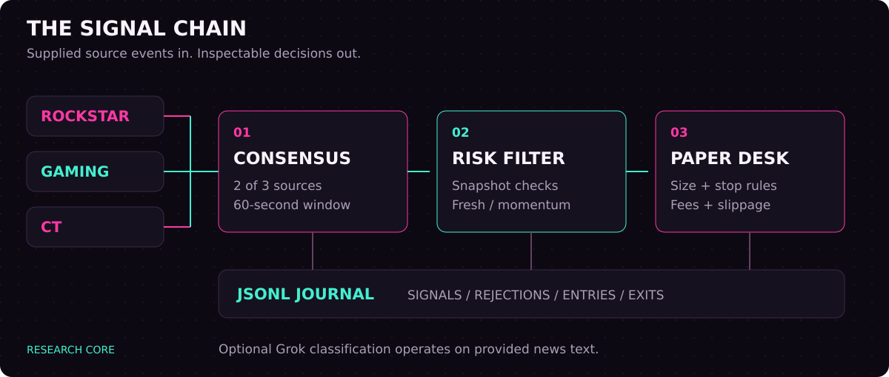</p>

| Layer | Default behavior |
| --- | --- |
| Radar | Same normalized keyword in at least two of `rockstar`, `gaming`, `ct` within 60 seconds |
| Fresh launches | Candidate age at most 30 minutes |
| Existing-token momentum | No maximum age; all other risk gates still apply |
| Risk | Known non-bundled status, dev share ≤2%, ≥10 holders, liquidity ≥5 SOL |
| Snapshot freshness | Risk check no more than 60 seconds old |
| Sizing | 0.1 SOL notional per entry, initial balance 1.2 SOL |
| Execution costs | 1% simulated fee and 1% slippage per side |
| Exits | 30% drop from peak or 40% drop from entry fill |
| Accounting | Realized P&L separate from estimated liquidation value of open positions |

<p align="center">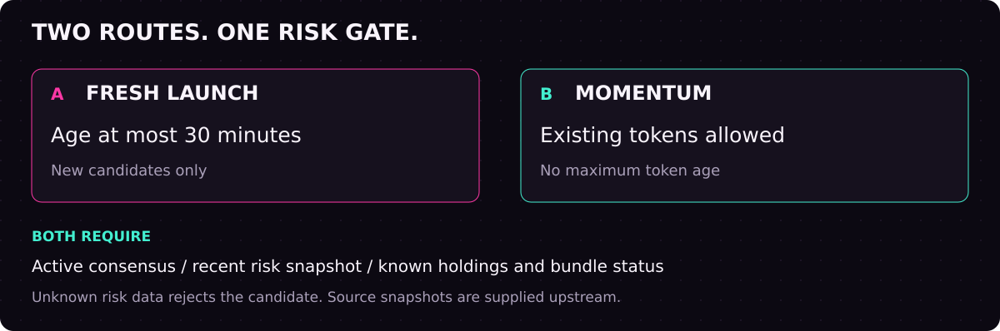</p>

Repeated posts from one source do not constitute consensus. Duplicate source/event IDs are ignored. A signal expires 60 seconds after the older of the two freshest distinct-source observations. A new position requires an active signal; an open position continues receiving price updates after signal expiry.

Stops fill at the next supplied price, including gaps, rather than assuming a guaranteed stop price. Positions still open at the end remain open and marked. Paper fills do not model pool impact, MEV, failed transactions, network fees, or executable liquidity.

<a id="replay"></a>
<p align="center">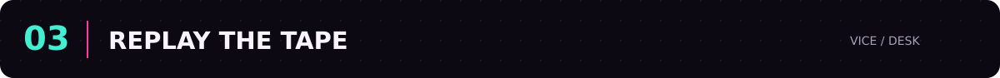</p>

```bash
npm run replay -- ./my-events.jsonl
```

Input is one JSON object per line in nondecreasing timestamp order. All timestamps are Unix milliseconds. Prices are **SOL per token**, never USD or market cap. Mint is an exact token identifier; the demo uses visibly fictional IDs.

```json
{"type":"news","ts":1800000000000,"source":"rockstar","id":"source-unique-id","keywords":["gta6"],"text":"Original source text"}
{"type":"news","ts":1800000015000,"source":"ct","id":"another-unique-id","keywords":["gta6"],"text":"Another source text"}
{"type":"candidate","ts":1800000016000,"mint":"DEMO-A","keyword":"gta6","strategy":"fresh","price":0.001,"createdAt":1799999900000,"checkedAt":1800000016000,"bundled":false,"devShare":0,"holders":120,"liquiditySol":20}
{"type":"price","ts":1800000030000,"mint":"DEMO-A","price":0.0005}
```

`devShare` is a fraction from 0 to 1. Missing/unknown risk fields reject the candidate. Source labels and snapshots are supplied by your ingestion pipeline: the desk cannot verify their authenticity. `bundled: false` is an upstream assessment, not a bundle detector implemented here. Candidate-to-keyword matching is likewise supplied upstream, never inferred from a ticker alone.

<a id="grok"></a>
<p align="center">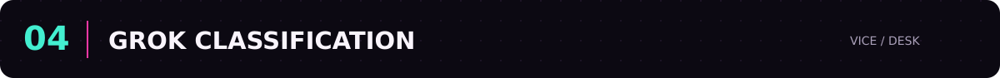</p>

Set `XAI_API_KEY` and `XAI_MODEL` to an available model in your xAI account, then:

```bash
cp .env.example .env
# Fill in the two values locally; never commit .env.
node --env-file=.env src/cli.mjs ./my-events.jsonl --grok
```

This makes paid API calls, one per news event, replacing its keyword list with validated Grok classifications. The small initial vocabulary is `gta6`, `preorder`, `bawsaq`, `dacity`; candidate keywords must use the same labels. The classifier uses the [xAI Responses API](https://docs.x.ai/developers/model-capabilities/text/comparison), a timeout, and strict label validation. API errors terminate the run; they never silently turn into buy signals. Offline tests mock the API; no paid integration call is part of the test suite.

Grok classifies **provided text**. It does not fetch Rockstar, RSS, X/CT, token launches, or chain data in this version. Replay timestamps measure dataset time, not real-world API latency. Irrelevant classifications are excluded from consensus.

<a id="repository"></a>
<p align="center">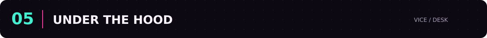</p>

```text
src/desk.mjs             consensus, risk gates, positions, accounting
src/grok.mjs             optional xAI classifier
src/cli.mjs              JSONL replay and journal export
examples/demo-events.jsonl   synthetic end-to-end fixture
test/desk.test.mjs       boundaries, risk, stops, costs, API contract
```

<a id="scope"></a>
<p align="center">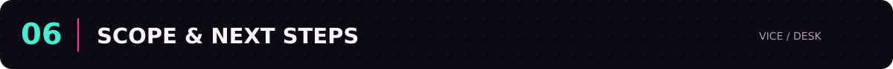</p>

This release is the inspectable research core. Continuous source ingestion, authenticated CT access, on-chain bundle/deployer analysis, persistent restart recovery, live quote validation, transaction execution, and partial exits are not implemented. Journals are written after a successful replay, not a crash-safe live trading ledger. Inputs are processed in memory, so use bounded replay files.

Before using external data, retain source URLs, observation times, full token mints, and the provenance of risk snapshots. Two websites repeating one story are two source labels, not proof of independent information. Research filters cannot establish that a token is safe.

<sub>Independent project by zostaff. Grok and Grand Theft Auto VI names and brand imagery identify the research theme; no affiliation or endorsement by xAI or Rockstar Games. Cover illustration generated for this repository.</sub>

<p align="center"><a href="https://github.com/zostaff">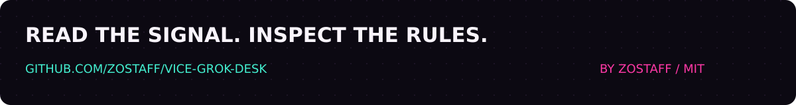</a></p>
